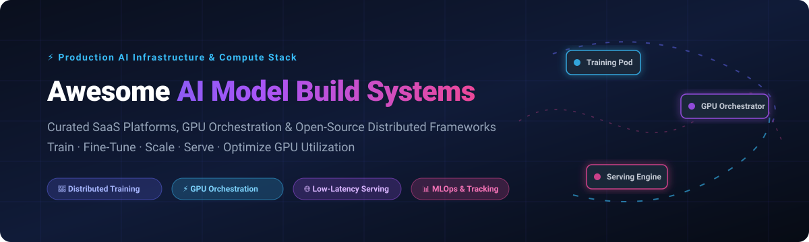

# Awesome AI Model Build Systems 🚀

<div align="center">

<a href="https://github.com/ishandutta2007/Awesome-Awesome-Awesome"></a><a href="https://discord.gg/jc4xtF58Ve"></a>
<a href="https://github.com/ishandutta2007/Awesome-AI-Model-Build-Systems/stargazers"></a>
<a href="https://github.com/ishandutta2007/Awesome-AI-Model-Build-Systems/network/members"></a>
<a href="https://github.com/ishandutta2007/Awesome-AI-Model-Build-Systems/blob/main/LICENSE"></a>
<a href="https://github.com/ishandutta2007"></a>

<br/><br/>

<a href="https://github.com/ishandutta2007/Awesome-AI-Model-Build-Systems">
  
</a>

<p align="center">
  <strong>Curated Index of Production AI Infrastructure, Distributed Training Frameworks, GPU Orchestrators &amp; Model Serving Engines</strong>
</p>

<p align="center">
  <a href="#-sector-overview--market-dynamics">Sector Dynamics</a> •
  <a href="#-saashosted-platforms">SaaS Platforms</a> •
  <a href="#-open-source-github-projects">Open-Source Ecosystem</a> •
  <a href="#-how-to-contribute">Contribute</a> •
  <a href="#-support--sponsorship">Support</a>
</p>

</div>

---

## 🌟 Overview &amp; Ecosystem Scope

This repository tracks notable **SaaS platforms** and **open-source projects** powering the **AI Model Build Systems** stack. These technologies deliver the distributed computing, cluster orchestration, GPU sharing, experiment management, and low-latency serving infrastructure necessary to build, fine-tune, and deploy foundation models and custom deep learning architectures at scale.

Whether you manage multi-node H100/B200 clusters on Kubernetes, seek serverless GPU inference, or design self-hosted post-training pipelines, this guide covers the entire landscape with concrete pricing, capacity metrics, and GitHub star analytics.

---

## 📑 Table of Contents

- [📊 Sector Overview &amp; Market Dynamics](#-sector-overview--market-dynamics)
- [☁️ SaaS/Hosted Platforms](#️-saashosted-platforms)
- [🛠️ Open-Source GitHub Projects](#️-open-source-github-projects)
- [🏗️ Building Custom In-House Stacks](#️-building-custom-in-house-stacks)
- [🤝 How to Contribute](#-how-to-contribute)
- [☕ Support &amp; Sponsorship](#-support--sponsorship)
- [📈 Star History](#-star-history)
- [⚖️ Disclaimer](#️-disclaimer)

---

## 📊 Sector Overview &amp; Market Dynamics

The global AI Infrastructure and Model Build Systems market is estimated at **$45B–$65B+** in 2026, expanding rapidly at an estimated **32%+ CAGR** fueled by enterprise foundation model training, post-training alignment, and inference at scale. Market dynamics reflect a **moderately fragmented, layered architecture** rather than a winner-take-all monopoly: hyperscalers and specialized Neo-clouds (CoreWeave, Lambda Labs) compete aggressively at the physical compute and bare-metal layer, while unified platforms (Databricks, Anyscale) and open-source standards (Ray, vLLM, PyTorch, Kubernetes) dominate orchestration and workload lifecycle management.

---

## ☁️ SaaS/Hosted Platforms

The following table summarizes enterprise SaaS and managed cloud platforms supporting AI model development, distributed training, and serverless inference. Entries are sorted descending by company scale (valuation / enterprise revenue).

| Platform / Company | Scale (Valuation / Revenue) | Pricing Model &amp; Specific Starting Tiers | Free Tier &amp; Trial Limits | Primary Strengths &amp; Target Workloads |
| :--- | :--- | :--- | :--- | :--- |
| **[Databricks](https://www.databricks.com/)** | **$43B+ valuation** (est. $2.6B+ ARR) | Pay-as-you-go DBU units; Standard compute starts at **$0.07/DBU**; Serverless GPU Mosaic AI training starts from **~$0.55/DBU** + cloud provider compute pass-through | **14-day free trial** with full platform capabilities, Unity Catalog access, and basic compute trial credits on your AWS/Azure/GCP account | Enterprise unified analytics, Mosaic AI Model Training (FSDP, DBRX fine-tuning), Unity Catalog governance, and integrated MLflow registry |
| **[CoreWeave](https://www.coreweave.com/)** | **$23B+ valuation** (est. $2B+ ARR run-rate) | Specialized GPU cloud compute; List rates start at **$2.21/GPU/hr** (A100 80GB) and **$6.16/GPU/hr** (H100 SXM); **Free data egress** between regions and client endpoints | **Free trial credits available upon sales onboarding** ($100–$500 POC pilot grant for approved engineering teams; no perpetual free tier) | Purpose-built AI hyperscaler, ultra-fast InfiniBand fabric, large-scale multi-node cluster training without egress penalty fees |
| **[Weights &amp; Biases](https://wandb.ai/)** | **$1.25B+ valuation** | Paid Team plan starts at **$50/user/month** (billed annually) or **$60/user/month** (monthly); Enterprise tier provides dedicated VPC and custom SSO | **Free Forever plan** for individual practitioners with 100GB artifact storage, 100 concurrent runs, unlimited projects, and Weave LLM tracing | MLOps experiment tracking, hyperparameter sweep optimization, dataset versioning, model registry, and LLM evaluation tracing |
| **[Run:ai (NVIDIA)](https://www.run.ai/)** | **~$700M acquisition** (by NVIDIA) | NVIDIA Cloud Platform / DGX Cloud enterprise subscription starting at **~$4,500/GPU/year**; Core scheduler and fractioning components also 100% open-sourced | **Free Community Edition** on NGC with Helm chart deployment for unlimited worker nodes with community support; enterprise trials include 30-day evaluation licenses | Dynamic GPU partitioning, fractional allocation, gang scheduling, fair-share queuing, and multi-tenant Kubernetes workload management |
| **[Modal](https://modal.com/)** | **~$300M+ valuation** (Series A) | Serverless execution billed per millisecond; CPU starts at **$0.000023/core-sec**; T4 GPU at **$0.59/hr**, A10G at **$1.10/hr**, A100 at **$4.43/hr**, and H100 at **$4.76/hr** | **$30/month in free compute credits** renewed perpetually for every individual user account with up to 10 concurrent containers | Instant sub-second container cold starts, Python-native decorator deployments, micro-batching, serverless LLM inference, and burst batch processing |
| **[Anyscale](https://www.anyscale.com/)** | **~$1B valuation** ($260M+ funding) | Pay-as-you-go cluster management starting at **$0.27/Anyscale Compute Unit (ACU-hr)** + underlying cloud provider compute; Enterprise custom VPC contracts available | **$50 one-time welcome compute credit** with a 14-day full platform trial; open-source Ray framework is free forever | Managed Ray platform, `@ray.remote` serverless clustering, Ray Train, Ray Serve, multi-cloud bursting, and zero-Kubernetes-headache operations |
| **[Lambda Labs](https://lambdalabs.com/)** | **~$1.5B valuation** | On-Demand Cloud starts at **$0.50/GPU/hr** (A10), **$1.29/GPU/hr** (A100 80GB), and **$2.49/GPU/hr** (H100 SXM5); Reserved 1-year instances discount up to 35% | **Free account setup with persistent storage tier access**; no perpetual free compute (occasional $10 promo credits during developer hackathons) | Cost-effective GPU on-demand cloud, 1-click Jupyter notebooks, Lambda Kubernetes Service (LKS) with automated GPU node health remediation |
| **[Predibase](https://predibase.com/)** | **Acquired by Rubrik (2025)** (est. $70M+ valuation) | Developer tier starts with serverless query pricing at **$0.0001/1K tokens**; Dedicated fine-tuning engines from **$8.00/training-hour** on A100 | **$25 free fine-tuning and inference credits** on initial signup with zero credit-card upfront requirement | Turbo LoRA, LoRAX serving (multiple fine-tuned adapters on single GPU), efficient small language model (SLM) training, and enterprise data lake integration |
| **[BentoCloud (BentoML)](https://bentoml.com/)** | **~$50M valuation** (Seed/Series A) | Pay-as-you-go serverless inference starting at **$0.05/hr/CPU** and **$0.70/hr** for GPU workers (NVIDIA T4); scale-to-zero autoscaling enabled by default | **$10 free usage credits** upon signup for testing Bento deployment endpoints, with unlimited local Bento building via open-source CLI | Turnkey containerized model serving, adaptive micro-batching, unified OpenAI-compatible endpoint generation, and multi-model pipelines |

---

## 🛠️ Open-Source GitHub Projects

Below is the definitive index of open-source projects for building, training, orchestrating, and serving AI models. Each repository includes an official social Stars_Badge linking directly to its stargazers page. The entries are sorted strictly in **descending order by GitHub Stars_Count**.

- **[Transformers](https://github.com/huggingface/transformers)** [](https://github.com/huggingface/transformers/stargazers)  
  *The core foundation library for state-of-the-art Machine Learning and deep neural network architectures (Apache-2.0).* Provides thousands of pretrained models for PyTorch, TensorFlow, and JAX with standardized interfaces for training, fine-tuning, and inference across NLP, vision, audio, and multimodal domains.

- **[PyTorch](https://github.com/pytorch/pytorch)** [](https://github.com/pytorch/pytorch/stargazers)  
  *The premier open-source deep learning and tensor computation platform (Modified BSD).* Powers modern distributed AI training with Fully Sharded Data Parallel (FSDP), TorchDynamo compiler optimization, distributed tensor parallel primitives, and massive GPU cluster scaling.

- **[vLLM](https://github.com/vllm-project/vllm)** [](https://github.com/vllm-project/vllm/stargazers)  
  *High-throughput and memory-efficient LLM serving engine (Apache-2.0).* Features **PagedAttention** algorithm for near-zero KV cache memory waste, continuous batching, chunked prefill, tensor and pipeline parallelism, and drop-in OpenAI-compatible API serving.

- **[Unsloth](https://github.com/unslothai/unsloth)** [](https://github.com/unslothai/unsloth/stargazers)  
  *Ultra-fast, memory-optimized LLM and SLM fine-tuning framework (Apache-2.0).* Delivers **2x–5x faster training speeds** and **70%–80% reduced VRAM usage** via manual OpenAI Triton kernels for LoRA, QLoRA, and full fine-tuning of Llama, Gemma, Mistral, and DeepSeek models.

- **[LLaMA-Factory](https://github.com/hiyouga/LLaMA-Factory)** [](https://github.com/hiyouga/LLaMA-Factory/stargazers)  
  *Easy-to-use, unified LLM post-training web UI and CLI platform (Apache-2.0).* Supports over 100 models with 16-bit, LoRA, QLoRA, DPO, PPO, ORPO, KTO alignment algorithms, multi-GPU scaling, and integrated web dashboard.

- **[Ray](https://github.com/ray-project/ray)** [](https://github.com/ray-project/ray/stargazers)  
  *The industry standard open-source unified distributed computing framework for AI (Apache-2.0).* Powers OpenAI's model training pipelines and Uber's platform. Includes **Ray Train** (distributed multi-node training), **Ray Serve** (scalable model serving), **Ray Tune** (HMM/HPO), and **Ray Core** (`@ray.remote` task distribution).

- **[DeepSpeed](https://github.com/deepspeedai/DeepSpeed)** [](https://github.com/deepspeedai/DeepSpeed/stargazers)  
  *Microsoft's deep learning optimization library for extreme-scale model training and inference (Apache-2.0).* Pioneers the **ZeRO** (Zero Redundancy Optimizer) memory architecture (ZeRO-1/2/3, ZeRO-Offload, ZeRO-Infinity), enabling trillion-parameter model training across commodity and high-end GPU clusters.

- **[MLflow](https://github.com/mlflow/mlflow)** [](https://github.com/mlflow/mlflow/stargazers)  
  *The most widely adopted open-source MLOps lifecycle platform (Apache-2.0).* Delivers full experiment tracking, code packaging via MLflow Projects, centralized Model Registry, prompt engineering evaluation, and multi-flavor deployment interfaces.

- **[Grok Build (xAI)](https://github.com/xai-org/grok-build)** [](https://github.com/xai-org/grok-build/stargazers)  
  *xAI's open-source terminal coding agent harness and developer tool (Apache-2.0).* Built in high-performance Rust with interactive TUI, MCP server integration, subagent scheduling, dynamic context retrieval, and local-first execution paradigms.

- **[LitGPT (Lightning AI)](https://github.com/Lightning-AI/litgpt)** [](https://github.com/Lightning-AI/litgpt/stargazers)  
  *Hackable, clean, production-ready framework to pretrain, fine-tune, evaluate, and deploy 20+ LLMs (Apache-2.0).* Zero boilerplate code, native PyTorch 2.x FSDP support, LoRA/QLoRA quantization, and direct command-line workflows.

- **[Axolotl](https://github.com/axolotl-ai-cloud/axolotl)** [](https://github.com/axolotl-ai-cloud/axolotl/stargazers)  
  *Declarative YAML-configured post-training and alignment framework (Apache-2.0).* Supports FSDP, DeepSpeed, LoRA, QLoRA, DPO, and flash-attention natively. Offers reproducible training configs from single GPU workstations to massive SLURM clusters.

- **[OpenLLM (BentoML)](https://github.com/bentoml/OpenLLM)** [](https://github.com/bentoml/OpenLLM/stargazers)  
  *Operating framework for serving and running open-source LLMs in production (Apache-2.0).* Integrates vLLM, TensorRT-LLM, and AutoGPTQ backends with OpenAI-compatible streaming endpoints and one-click cloud container builds.

- **[Triton Inference Server](https://github.com/triton-inference-server/server)** [](https://github.com/triton-inference-server/server/stargazers)  
  *NVIDIA's enterprise-grade multi-framework inference serving software (Apache-2.0).* Maximizes GPU and CPU compute utilization with concurrent model execution, dynamic batching, model ensembles, and C++/Python/gRPC/HTTP APIs.

- **[Xinference](https://github.com/xorbitsai/inference)** [](https://github.com/xorbitsai/inference/stargazers)  
  *Distributed inference framework for LLMs, speech recognition, and multimodal generation (Apache-2.0).* Automatically orchestrates model shards across heterogeneous devices (NVIDIA GPUs, Apple Silicon Metal, AMD ROCm, and CPUs).

- **[BentoML](https://github.com/bentoml/BentoML)** [](https://github.com/bentoml/BentoML/stargazers)  
  *The unified model serving and deployment framework for production ML systems (Apache-2.0).* Packages models, runtime environments, and inference logic into standardized deployable Bento artifacts with automatic micro-batching and containerization.

- **[KServe](https://github.com/kserve/kserve)** [](https://github.com/kserve/kserve/stargazers)  
  *Standardized cloud-native model serving platform on Kubernetes (Apache-2.0).* Provides high-performance, serverless inference with scale-to-zero, GPU autoscaling, canary rollouts, explainability, and v2 data plane protocols.

- **[TorchTitan](https://github.com/pytorch/torchtitan)** [](https://github.com/pytorch/torchtitan/stargazers)  
  *PyTorch's clean, native showcase repository for distributed large-scale model pre-training (BSD-3-Clause).* Demonstrates 3D parallelism (Tensor, Pipeline, and FSDP2 Parallelism) using native PyTorch components without external third-party dependencies.

- **[LitServe (Lightning AI)](https://github.com/Lightning-AI/LitServe)** [](https://github.com/Lightning-AI/LitServe/stargazers)  
  *Ultra-fast, lightweight Python serving engine for AI models (Apache-2.0).* Provides built-in batching, streaming, auto-scaling, and multi-GPU workers with lower latency and higher requests-per-second throughput than standard FastAPI backends.

- **[NVIDIA GPU Operator](https://github.com/NVIDIA/gpu-operator)** [](https://github.com/NVIDIA/gpu-operator/stargazers)  
  *Automates the management of NVIDIA software components on Kubernetes (Apache-2.0).* Dynamically provisions drivers, NVIDIA Container Toolkit, GPU feature discovery, Multi-Instance GPU (MIG) slicing, and DCGM monitoring metrics across heterogeneous clusters.

- **[KAI Scheduler](https://github.com/kai-scheduler/KAI-Scheduler)** [](https://github.com/kai-scheduler/KAI-Scheduler/stargazers)  
  *Kubernetes batch and GPU scheduler powering NVIDIA Run:ai architecture (CNCF Sandbox, Apache-2.0).* Features gang scheduling, bin-packing, hierarchical queues, Dominant Resource Fairness (DRF), and GPU fractional resource consolidation.

- **[AIBuildAI (UCSD)](https://github.com/aibuildai/AI-Build-AI)** [](https://github.com/aibuildai/AI-Build-AI/stargazers)  
  *Autonomous multi-agent system that engineers and builds AI pipelines end-to-end (Open-source).* Achieved 63.1% win rate on OpenAI MLE-Bench with specialized Manager, Designer, Coder, and Tuner agents coordinating across on-disk trajectories.

- **[Flowillower](https://github.com/THU-CVML/flowillower)** [](https://github.com/THU-CVML/flowillower/stargazers)  
  *Distributed, Git-native experiment tracking and model explanation tool (Apache-2.0).* Lightweight, decentralized alternative to SaaS platforms; keeps all tracking runs stored directly in Git directories without external centralized servers.

- **[RunRaccoon](https://github.com/Gene-Weaver/RunRaccoon)** [](https://github.com/Gene-Weaver/RunRaccoon/stargazers)  
  *Local-first, drop-in replacement for experiment tracking (Open-source).* Integrates directly with Ultralytics and YOLO workflows, saving metrics into human-readable JSONL files, colorblind-safe charts, and training-progress media.

---

## 🏗️ Building Custom In-House Stacks

Modern enterprise engineering teams can compose a production-grade, vendor-agnostic AI model build platform by layering these modular open-source systems:

```
┌────────────────────────────────────────────────────────┐
│               Model Serving & API Gateways             │
│          vLLM  •  Triton  •  BentoML  •  LitServe      │
├────────────────────────────────────────────────────────┤
│           Fine-Tuning & Alignment Orchestration         │
│         Unsloth  •  Axolotl  •  LLaMA-Factory          │
├────────────────────────────────────────────────────────┤
│             Distributed Compute & Scheduling           │
│        Ray Train  •  DeepSpeed  •  TorchTitan          │
├────────────────────────────────────────────────────────┤
│        Cluster Orchestration & GPU Fractioning         │
│     Kubernetes + KAI Scheduler + NVIDIA GPU Operator   │
├────────────────────────────────────────────────────────┤
│             Observability & Experimentation            │
│                 MLflow  •  Weights & Biases            │
└────────────────────────────────────────────────────────┘
```

---

## 🤝 How to Contribute

We welcome additions, corrections, and benchmark updates from the AI infrastructure community! 

1. **Fork** the repository: `https://github.com/ishandutta2007/Awesome-AI-Model-Build-Systems`
2. **Create a branch**: `git checkout -b feature/add-new-build-system`
3. **Add entry** to `README.md`:
   - For SaaS products: include specific starting tier pricing and specific free trial/plan limits.
   - For Open-Source projects: follow the Stars_Badge formatting with `style=social&color=white` and link to the repo's `/stargazers` page. Place it sorted strictly by Stars_Count.
4. **Commit and open a Pull Request** with a concise summary of the addition.

---

## ☕ Support &amp; Sponsorship

If this curated repository saved you time, compute costs, or helped you architect your AI infrastructure, please consider showing your support:

- ⭐ **Star this repository** to help others discover it!
- 🍴 **Fork and share** it with your ML and platform engineering colleagues.
- ☕ **Buy me a coffee / Sponsor the author** via the GitHub Sponsor Dashboard:  
  👉 **[Sponsor @ishandutta2007 on GitHub Sponsors](https://github.com/sponsors/ishandutta2007)**

Your generous sponsorship directly supports ongoing maintenance, community benchmarking, and open-source infrastructure research!

---

## 📈 Star History

[](https://star-history.dera.page/#ishandutta2007/Awesome-AI-Model-Build-Systems&type=date&legend=top-left)

---

## ⚖️ Disclaimer

- This is a **community-curated index** provided for educational and architectural reference—not a commercial endorsement.
- All pricing, tier limits, and feature sets reflect publicly published information as of 2026 and may change based on vendor revisions.
- Production workloads handling regulated customer datasets must ensure compliance with applicable data privacy statutes (GDPR, HIPAA, CCPA) and upstream model weight licenses.

---

<div align="center">
  <sub>Built with ❤️ for ML Platform Engineers, Distributed Systems Researchers, and AI Infrastructure Architects.</sub>
</div>
